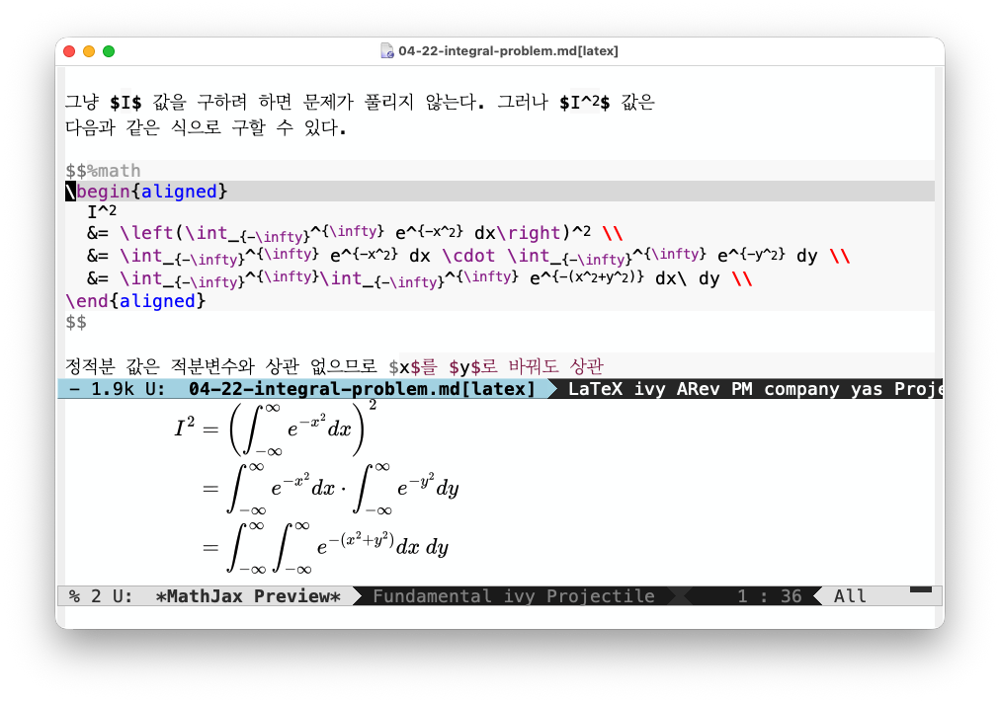

# mathjax-preview

MathJax-Preview lets you quickly and easily render and preview MathJax
expressions in a dedicated buffer. It is handy if you want to check
how your math formula is rendered.

## Installation

1. Install `rendermj`
`mathjax-preview` internally uses
[rendermj](https://www.npmjs.com/package/rendermj) command, you need
to install `rendermj` first.
```console
npm install rendermj -g
```
2. Copy `mathjax-preview.el` into `~/.emacs.d/lisp`.
3. Then add the following to `init.el`.
```elisp
(use-package mathjax-preview)
```

## Usage
Once it's successfully loaded, you can use `mathjax-preview-at-point`
to render and preview a math formula at the current cursor
position. You may want to assign a shortcut like `C-c m p`.


